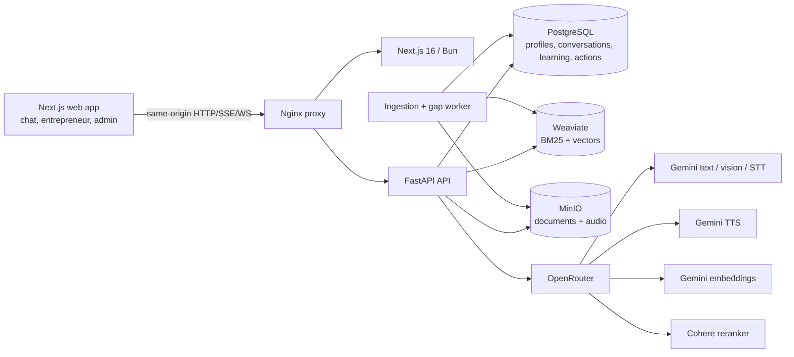
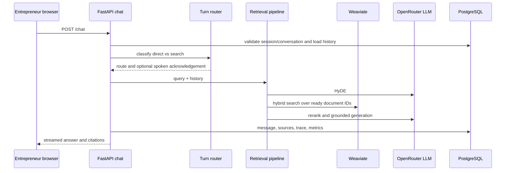

# Inkomoko Assistant Comprehensive Product and Engineering Audit

**Audit date:** 2026-10-26  
**Repository:** `/Users/admin/Documents/incomoco`  
**Scope:** repository inspection and safe, non-destructive verification only. No application code, configuration, migration, dependency, or persistent data was changed for this audit.

## A. Executive Summary

Inkomoko Assistant is a credible working MVP foundation, not yet a production-ready digital adviser. The strongest parts are the grounded-answer architecture, a persistent entrepreneur/context model, an explainable learning-and-action registry, a usable admin surface, and explicit voice capability gating. The repository contains more than a chat demo: it connects approved documents, learning resources, business actions, progress evidence, adviser escalation, analytics, and audio storage.

The main limitation is product continuity and proof. The system can recommend an approved lesson and record a business action, but it does not yet demonstrate a complete, durable learning loop with objectives, practice, knowledge checks, evidence quality, repeated support, and measured business outcomes. Much of the entrepreneur experience is seeded/demo-oriented. Live provider quality, native-language speech quality, production authentication, tenant isolation, operations, and mobile performance still require evidence outside the current automated suite.

**Overall judgment:** suitable for a controlled internal demo and a narrow, instrumented pilot after security/configuration hardening; not suitable for an unsupervised public or beneficiary rollout.

## B. Feature Inventory

| Feature | Status | Evidence | Risk | Recommendation |
|---|---|---|---|---|
| Web chat and SSE streaming | Implemented; automated coverage exists | `apps/web/features/chat/*`; `apps/api/app/api/v1/chat.py:26` | External-provider failures and slow first response are not proven in production | Add browser E2E and provider timeout/error telemetry |
| RAG ingestion | Implemented | `apps/api/app/workers/ingest_worker.py`; `apps/api/app/rag/ingestion/*` | Parsing and retrieval quality are not evaluated against a golden set | Create approved multilingual evaluation set |
| Grounded answers and citations | Implemented in pipeline; quality partially verified | `apps/api/app/rag/pipeline.py:38`; `apps/api/app/rag/generation/answer.py`; `MessageSource` in `orm.py:292` | Retrieval can be empty or poorly matched; no measured factuality | Require answer/source evaluation before pilot |
| Entrepreneur profile and guest session | Implemented | `apps/api/app/api/v1/entrepreneur.py`; `orm.py:57`; `schemas/entrepreneur.py` | Guest-to-registered identity linking is not a complete user-account system | Define identity provider and account-linking contract |
| Today dashboard | Implemented, demo/seed dependent | `apps/api/app/api/v1/dashboard.py`; `apps/web/app/home/page.tsx` | Recommendations and progress can feel static; limited evidence of return-day behavior | Add end-to-end journey tests and real content fixtures |
| Learning registry | Implemented | `LearningSkill` and `LearningResource`, `orm.py:188-231`; learning admin routes | Resource is primarily metadata/content pointer; no quiz or structured lesson model | Add objective, activity, assessment, and versioning model |
| Learning progress/evidence | Partially implemented | `LearningProgress` and `SkillEvidence`, `orm.py:144-167`; `learning.py` | Evidence is a free-text/result record, not validated application evidence | Define evidence types and adviser review workflow |
| Business goals/actions | Implemented deterministic rules | `BusinessGoal`/`BusinessAction`, `orm.py:90-128`; `services/learning.py`; `dashboard.py` | Static keyword/rule recommendations may not reflect real context | Add explicit reason codes and outcome evaluation |
| Human adviser escalation | Implemented as queue | `AdviserQueueItem`, `orm.py:130-142`; `adviser_admin.py`; web adviser queue | No adviser identity, assignment, SLA, notes, or entrepreneur-facing case conversation | Build case ownership and communication model |
| Admin dashboard | Implemented | `apps/web/app/admin/*`; `features/auth/components/admin-shell.tsx` | Single admin credential model; broad role | Add RBAC, audit review, and production identity integration |
| Voice dictation/STT | Implemented; language quality unverified | `api/v1/voice.py`; `adapters/openrouter/speech.py`; voice hooks | Provider response does not prove Amharic/Oromo/Somali accuracy | Run recorded multilingual WER/CER evaluation |
| Amharic/English TTS | Enabled by configuration | `core/config.py:32-43`; `voice_service.py`; `MessageAudio` | Intelligibility and latency are not fully verified under real use | Native-speaker sign-off and operational metrics |
| Oromo/Somali TTS | Explicitly disabled | `core/config.py:35-36`; `docs/AFaan_OROMO_TTS_VALIDATION.md` | Existing provider may return audio despite poor language quality | Keep disabled until native evaluation |
| Analytics/knowledge gaps | Implemented | `api/v1/analytics.py`; `GapReport`, `orm.py:417-424` | Mostly question/topic signals, not business outcome measurement | Add funnel, lesson, action, and outcome metrics |
| Docker local stack | Implemented for development | `docker-compose.yml`; `README.md:10-52` | Compose is not a production deployment or recovery plan | Add environment-specific deployment and backup runbooks |

## C. Architecture Review

### Actual architecture

### Chat/RAG data flow

### Architectural strengths

- Ports/adapters separate LLM, embeddings, reranking, TTS, vector search, and object storage (`apps/api/app/domain/ports.py`, `app/adapters/*`).
- The retrieval pipeline records stage timings and stores retrieval traces (`orm.py:329-342`), which is a useful foundation for evaluation.
- Language values are constrained at the database boundary for profiles, conversations, messages, documents, and resources (`orm.py:60-64`, `237-260`, `367-368`).
- Generated audio cache keys include language, model, voice, and text hash (`services/voice_service.py:32-36`).

### Architectural inconsistencies and unused/underused areas

- The README still describes the product as bilingual while the data contracts and UI expose four languages (`README.md:3`, `orm.py:61`, `config.py:35-36`). This creates expectation and documentation drift.
- `detect_lang()` is intentionally only Amharic-vs-English script detection (`rag/language.py:28-31`). It is safe only when explicit language is passed; callers that omit it cannot distinguish Oromo, Somali, and English Latin script.
- `ChatSession` is the effective anonymous identity. There is no general user/authentication table or verified beneficiary login in the inspected ORM model; `BeneficiaryLink` is a link record, not a complete identity lifecycle (`orm.py:170-185`).
- Learning resources, documents, and RAG chunks are related by optional references, but the content registry does not enforce that an approved lesson has a ready document, valid media, or translated equivalent.
- MinIO and Weaviate are configured as development Compose services with anonymous Weaviate access and default credentials (`docker-compose.yml:103-108`, `124-125`).

## D. End-to-End Entrepreneur Journey

| Journey step | Current result | Evidence and break |
|---|---|---|
| New visitor opens app | Exists | Next routes `/`, `/welcome`, `/chat`, `/home` |
| Select language | Exists and persists in profile/conversation contracts | `locale-toggle.tsx`, `orm.py:61`, `Conversation.lang`; UI/content mismatch remains possible |
| Register or guest | Guest session exists | `entrepreneur.py:23`; registered account flow is not evident in the inspected code |
| Describe business | Profile patch exists | `entrepreneur.py:32-50`; onboarding completion and validation need browser proof |
| Explain challenge | Profile has `primary_business_challenge` | `orm.py:79`; no robust intake history or change audit is evident |
| Receive recommendation | Exists through rules and seeded recommendations | `services/learning.py`; recommendation quality is not measured |
| Open lesson | Exists | `learning.py`, `/learning/resources/[id]`; resource content can be metadata/source-linked rather than a complete lesson |
| Understand lesson | Basic title/description/content/media display | No structured objectives, examples, or comprehension check model found |
| Complete activity | Limited | `LearningEvent`, `LearningProgress`, and business action endpoints exist, but no quiz/assignment submission contract is present |
| Receive practical action | Exists | `BusinessAction` and dashboard service |
| Record progress | Exists for counters/status | `dashboard.py`; evidence quality and idempotency under concurrent clicks require stronger proof |
| Return another day | Intended by dashboard state and timestamps | No browser/session regression test demonstrates day-over-day continuity |
| Follow-up | Queue/date fields exist | `follow_up_at` and queue exist, but a scheduler/notification delivery path is not evident |
| Ask AI adviser | Exists | Chat and RAG route; personalized context injection needs deeper verification |
| Request human help | Exists as queue item | `/admin/adviser-queue`; no complete entrepreneur-facing case lifecycle |
| Review goals/progress | Exists in My Business/dashboard | Coverage is status-oriented; outcome evidence is thin |

**Conclusion:** the product currently feels like a set of connected MVP surfaces rather than one proven continuous journey. The critical missing link is the learning-to-practice-to-evidence loop.

## E. AI and Personalization Review

The system knows profile name, business identity/type/stage/location, preferred language and format, experience level, challenge, learning goal, goals, actions, skill progress, evidence, conversations, messages, and retrieval traces. These are persistent for a session/profile in PostgreSQL (`orm.py:57-87`, `144-167`, `234-342`).

Personalization is primarily deterministic and explainable. `services/learning.py` uses keyword/topic matching and profile fields to select approved resources; dashboard assembly joins seeded/current lessons, goals, actions, and progress. This is appropriate for an MVP because it is auditable, but it is not evidence of adaptive ML or deep business intelligence.

### Hana trace, without modifying data

The demo login endpoint selects a demo persona (`dashboard.py:20`), after which the dashboard reads Hana’s profile and current action. A current lesson is selected from approved learning resources, the UI links to its resource detail, and the business action exposes a count such as `5 / 7 days`. A follow-up response posts to `/me/actions/{action_id}/follow-up` (`dashboard.py:57-81`) and invalidates the dashboard query. This proves a seeded demonstration path; it does not prove that a newly onboarded entrepreneur receives equally coherent recommendations.

### Deterministic vs generated behavior

- Deterministic: language contracts, profile/action state, progress counters, resource approval, ready document filtering, cache keys, and queue status.
- Generated: HyDE, routing phrasing, grounded answer prose, embeddings, reranking, PDF vision conversion, STT, and TTS.
- Risk boundary: the generated model is asked to answer from retrieved context, but the repository does not establish a comprehensive policy/risk classifier for loan, eligibility, or financial advice claims. Approved source coverage and refusal evaluation are therefore essential.

## F. Learning Effectiveness Review

Genuine capabilities include a skill registry, approved resource states, language metadata, difficulty metadata, progress rows, completion evidence text, learning events, business actions, and skill evidence (`orm.py:144-231`, `440-451`). The admin can create/edit skills and resources and move resources through draft/review/approved/archived (`api/v1/learning_admin.py`).

Missing or weak capabilities include explicit learning objectives, lesson sections, local examples, interactive practice, quizzes, answer scoring, retry/remediation, assignment evidence capture, adviser review of evidence, and outcome measurement. A resource can be a document, guideline, audio, video, or text lesson, but the data model does not represent the instructional structure needed to prove learning.

**Cash-flow judgment:** the current platform can reasonably direct an entrepreneur to an approved cash-flow resource and then ask them to record a simple business action. It cannot yet reliably demonstrate that the entrepreneur understood cash flow, practiced it, received corrective feedback, or applied it accurately in the business. It is a recommendation-and-accountability loop, not yet a complete learning intervention.

## G. Multilingual and Voice Review

| Capability | Amharic `am` | English `en` | Afaan Oromo `om` | Somali `so` |
|---|---|---|---|---|
| UI selector/contract | Implemented | Implemented | Implemented | Implemented |
| Profile/conversation/message storage | Implemented | Implemented | Implemented | Implemented |
| Chat prompt label | Implemented | Implemented | Implemented | Implemented |
| Language detection fallback | Ethiopic heuristic | Latin fallback | Not distinguishable from English | Not distinguishable from English |
| RAG documents/resources | Schema supports | Schema supports | Schema supports; actual coverage unverified | Schema supports; actual coverage unverified |
| STT | Provider path exists; accuracy unverified | Provider path exists | Provider path exists if provider accepts hint; accuracy unverified | Provider path exists if provider accepts hint; accuracy unverified |
| TTS | Enabled | Enabled | Disabled by `tts_allowed_langs` | Disabled by `tts_allowed_langs` |
| Native-speaker review | Required | Required for quality | Required before enabling | Required before enabling |

The strongest safety decision is keeping `TTS_ALLOWED_LANGS=am,en` (`core/config.py:35-36`) and surfacing unsupported-language errors instead of silently producing audio. The provider returning playable bytes is not language-quality evidence. Oromo and Somali require recorded test sets, transcription/translation checks, native intelligibility ratings, and production latency/error measurement.

The current UI also preserves source-language lesson content and displays a notice when the selected UI language differs. This is preferable to silently translating approved business records or lessons, but the fallback experience needs complete language-specific copy and content coverage reporting.

## H. UX and Accessibility Review

Screens exist for welcome, chat, Today, Learn, lesson detail, My Business, admin, and adviser queue (`apps/web/app/*`). The recent composition pass improved grouping and language notices, and the 390px Learn screen was visually inspected during the prior verification pass.

Five highest-impact UX problems:

1. **The learning loop is not explicit enough.** A resource and a business action are adjacent, but the user is not consistently shown objective, practice, evidence, and next follow-up.
2. **Content availability is unclear across languages.** A selected Oromo/Somali UI can show Amharic/English lesson content; the notice exists, but this can still feel like a broken translation rather than a deliberate source-language fallback.
3. **Chat has limited adviser continuity.** Conversation history and citations exist, but a clear “what we know about your business” and human-escalation state is not consistently part of the conversation experience.
4. **Mobile performance is a pilot risk.** The dev environment showed slow document/API completion during verification and the voice activity detector adds a large browser bundle. Low-cost Android behavior is not covered by browser E2E evidence.
5. **Admin and adviser workflows are operationally thin.** Tables and queue actions exist, but assignment, ownership, notes, SLA, and resolution evidence are missing, which makes human handoff difficult to operate at scale.

Accessibility foundations are present in places: buttons, headings, progressbar labels, and language controls are represented in the DOM. However, there is no automated accessibility suite or keyboard/screen-reader regression suite in the repository. Ethiopic rendering, focus order, touch targets, error announcements, and offline behavior need device-level checks.

## I. Security and Data Integrity Review

### Positive controls

- Admin tokens are JWTs with role and expiry (`core/security.py:27-44`), and admin routes use a shared dependency (`api/deps.py:37-44`).
- Admin login uses constant-time username comparison and bcrypt verification (`security.py:20-24`).
- Chat repository methods generally receive a session ID, and voice message replay explicitly checks session ownership (`services/voice_service.py:112-126`).
- Upload size is configurable and documents have checksums/statuses/deletion states (`core/config.py:67`; `orm.py:360-415`).
- Rate limits exist for chat and voice configuration (`core/config.py:82-83`).
- WebSocket origin checks are implemented in `voice.py:116-133`.

### High-risk findings requiring hardening or validation

- Default admin credentials and a placeholder JWT secret are present in runtime defaults (`core/config.py:70-75`, `README.md:29`). This is unacceptable for any shared deployment.
- Weaviate anonymous access is enabled in Compose (`docker-compose.yml:103-108`), and MinIO uses default credentials in the development stack. Network isolation and production credentials are not demonstrated.
- `EntrepreneurProfile.user_id` is a nullable UUID without a foreign key to a user table (`orm.py:69-72`). Registered beneficiary identity, account linking, revocation, and tenant isolation are not proven.
- The admin authorization model is a single global admin role. There is no separate adviser/content reviewer/analyst permission boundary visible in the inspected routes.
- Prompt-injection resistance is not established. Documents and retrieved text become model context; provenance and instruction/data separation should be tested with hostile document content.
- Logging/audit models exist, but retention, redaction, access review, and production log destinations are not defined in the repository evidence.

These are risk findings, not confirmed exploit demonstrations. A pre-pilot security test should include two independent sessions, admin/adviser role tests, object-key authorization tests, malicious upload cases, and prompt-injection fixtures.

## J. Production Readiness and Cost Review

Compose provides a useful local topology: proxy, web, API, worker, PostgreSQL, Weaviate, and MinIO, with API health checks and automatic Alembic upgrade on startup (`docker-compose.yml:51-81`; `README.md:31-41`). It is not a production operating model: there is no CI/CD workflow visible, no backup/restore automation, no rollback procedure, no durable secrets strategy, no monitoring/alerting configuration, and no autoscaling or managed-service definition.

### Illustrative capacity assumptions

These are planning scenarios, not vendor quotes. Assume 20 active days/month, 5 chat questions per active day, 1000 input + 700 output tokens per answer, 2 minutes of voice input per active day for 20% of users, 10 read-aloud requests per month, and 25 MB of approved uploads per entrepreneur/year. Actual model prices, cache hit rates, and provider billing must be supplied before a commercial budget.

| Scale | Chat turns/month | Approx. generated text tokens/month | Voice input/month | Storage growth/year |
|---|---:|---:|---:|---:|
| 100 active entrepreneurs | 10,000 | 17 million | 800 minutes | 2.5 GB |
| 1,000 active entrepreneurs | 100,000 | 170 million | 8,000 minutes | 25 GB |
| 10,000 active entrepreneurs | 1,000,000 | 1.7 billion | 80,000 minutes | 250 GB |

Infrastructure will be driven by LLM/STT/TTS/embedding/rerank provider pricing, PDF vision work, vector index size, concurrency, audio duration, and cache hit rate. Reliable cost modeling needs real request counts, token telemetry by model, audio seconds, document pages, storage egress, peak concurrency, and provider pricing/contract terms. At 10,000 active entrepreneurs, managed PostgreSQL, object storage, vector service, queue/worker scaling, observability, and provider quotas should be assumed rather than one Compose host.

## K. Test Coverage and Verification

### Executed for this audit

- Backend: `46 passed, 4 skipped` using `apps/api/.venv/bin/pytest -q`.
- Backend lint: `apps/api/.venv/bin/ruff check app tests` passed.
- Frontend TypeScript: `tsc --noEmit` passed using the bundled runtime at `/Users/admin/.cache/codex-runtimes/codex-primary-runtime/dependencies/node/bin/node` because the host Homebrew Node/ICU installation is broken.
- Frontend ESLint: passed using the same bundled runtime.
- Repository inspection: routes, models, migrations, providers, Compose topology, admin UI, and existing tests were read.

### Existing test profile

The backend suite covers chunking, entrepreneur behavior, fake/integration paths, origin handling, TTS hedging, phase closure, and text processing (`apps/api/tests/*`). It is valuable but heavily dependent on fake adapters and seeded/demo fixtures. Four tests are skipped. There is no evident browser E2E suite, visual regression suite, accessibility suite, native-speaker language evaluation, load test, backup/restore test, or production-provider golden-answer suite.

### Not verified in this audit

- Live OpenRouter answer/STT/TTS quality, because that would incur provider cost and require representative recordings and human review.
- Full browser journey at all requested viewports and real low-cost Android hardware.
- Production authentication, beneficiary linking, multi-tenant authorization, and recovery operations.
- Actual multilingual document coverage and factual answer quality against an approved evaluation set.

## L. Top 15 Findings

| ID | Severity | Finding and impact | Evidence/root cause | Next step | Effort | Confidence |
|---|---|---|---|---|---|---|
| F-01 | Critical | Default admin password and placeholder JWT secret can expose the whole admin surface | `core/config.py:70-75`; `README.md:29` | Require startup failure for unsafe production secrets and integrate real admin identity | Medium | High |
| F-02 | Critical | Beneficiary identity and account isolation are not proven | Nullable `user_id`, no user table/foreign key in `orm.py:69-72` | Define authenticated identity, link/revoke flows, and cross-account tests | Large | High |
| F-03 | High | RAG factual safety is not demonstrated for eligibility/finance questions | RAG pipeline exists, but no golden factuality/refusal suite | Build approved-source evaluation and policy refusal tests | Large | High |
| F-04 | High | Learning lacks objective, practice, quiz, and assessed evidence | Resource/progress models in `orm.py:144-231` have no assessment entities | Add a smallest structured lesson/activity contract | Large | High |
| F-05 | High | Human handoff is a queue, not a complete case workflow | `AdviserQueueItem` has no assignee, notes, SLA, or case messages | Add case ownership and communication states | Medium | High |
| F-06 | High | Oromo/Somali content and speech quality are not evidenced | Four-language schemas but only `am,en` TTS enabled | Create native-reviewed language matrix and coverage dashboard | Medium | High |
| F-07 | High | Latin-script fallback cannot distinguish Oromo, Somali, English | `rag/language.py:28-31` | Make explicit/persisted language mandatory in all user flows; test fallback refusal | Small | High |
| F-08 | High | Production operations are absent beyond local Compose | `docker-compose.yml`, no visible CI/backup/monitoring config | Create deployment, backup, alert, rollback runbooks | Large | High |
| F-09 | Medium | Recommendation logic is explainable but mostly keyword/static | `services/learning.py` keyword map and seeded actions | Add challenge taxonomy, reason codes, and outcome feedback | Medium | High |
| F-10 | Medium | Follow-up fields exist without proven notification/scheduling delivery | `BusinessAction.follow_up_at`; no clear notifier path | Implement scheduled follow-up worker with delivery status | Medium | Medium |
| F-11 | Medium | Admin permissions are too broad for content, adviser, and analytics roles | Shared `AdminUser` dependency | Introduce role claims and route-level permissions | Medium | High |
| F-12 | Medium | Mobile performance and voice bundle may be problematic on low-cost devices | ONNX VAD dependency and slow dev observations | Measure cold load, interaction latency, and memory on target devices | Medium | Medium |
| F-13 | Medium | No browser/accessibility regression coverage | Tests are backend-focused; no Playwright/a11y suite listed | Add critical-path browser tests and axe/manual screen-reader checks | Medium | High |
| F-14 | Medium | Source-language fallback can be confusing despite notices | UI supports notices but resource coverage is not enforced | Show availability before selection and require approved translation metadata | Small | High |
| F-15 | Low | Documentation and product claims lag the four-language implementation | `README.md:3` says bilingual | Update product/support documentation after capability sign-off | Small | High |

## M. Recommended Priorities

### Must fix before pilot

- Replace default secrets/credentials; disable anonymous infrastructure access; define TLS, secret storage, and network boundaries.
- Implement and test real identity/account linking and cross-account authorization.
- Create a golden evaluation set for Inkomoko services, eligibility, financing, training, out-of-scope questions, and personalized context.
- Add a structured cash-flow lesson with one objective, one local example, one practice task, one knowledge check, and evidence submission.
- Keep Oromo/Somali TTS disabled until native review; document the language capability matrix.
- Add browser tests for onboarding, language selection, Today action, lesson opening, chat, escalation, and admin authorization.

### Should improve during pilot

- Add adviser assignment, notes, SLA, and entrepreneur-facing case status.
- Add follow-up scheduling/delivery status and outcome instrumentation.
- Measure mobile performance and voice quality on representative Android devices.
- Add content coverage/version dashboards and reviewer workflow.

### Later enhancements

- WhatsApp/Telegram channel adapters behind the same conversation/profile ports.
- More adaptive recommendation models after enough labeled outcome data exists.
- Richer analytics and cohort comparisons.

### Defer or remove

- Do not expand voice languages solely because a provider returns playable audio.
- Do not add broad autonomous business intelligence or loan eligibility automation before source, policy, and outcome evidence are mature.
- Do not introduce a second RAG or speech architecture.

## N. Open Questions for Product Owner

1. What exact identity system will registered Inkomoko beneficiaries use, and what data may be synced from existing systems?
2. Which Inkomoko policies are approved for AI answers, and which questions must always route to a human?
3. Who owns approval and versioning of lesson content in each language?
4. What evidence counts as successful cash-flow practice: a text reflection, transaction record, adviser confirmation, or another artifact?
5. What are acceptable response latency, speech quality, and provider cost limits for the pilot?
6. What adviser team, hours, SLA, escalation priority, and privacy policy will govern human handoff?
7. Which pilot cohort and device/network conditions should define readiness?
8. Are guest conversations retained, and how can a guest later claim or delete their data?

## O. Suggested Next Development Phase

The smallest coherent milestone is **Cash-Flow Practice Loop v1**:

1. Select one approved cash-flow lesson in Amharic and English, with Oromo/Somali coverage explicitly marked unavailable where applicable.
2. Add a structured objective, one short explanation, one local example, one deterministic practice prompt, and one simple knowledge check.
3. Persist a submission/evidence record linked to the entrepreneur, lesson, skill, and business action.
4. Give the adviser queue a review state for failed/uncertain evidence.
5. Add one return-visit follow-up and measure completion, retry, escalation, and self-reported application.
6. Test the complete path with Hana and one non-demo profile, without using generated AI text as the sole evidence of learning.

This milestone directly improves entrepreneur outcomes, validates the existing architecture, and creates the evidence needed to decide whether broader learning content, channels, or adaptive recommendations are worth building.

